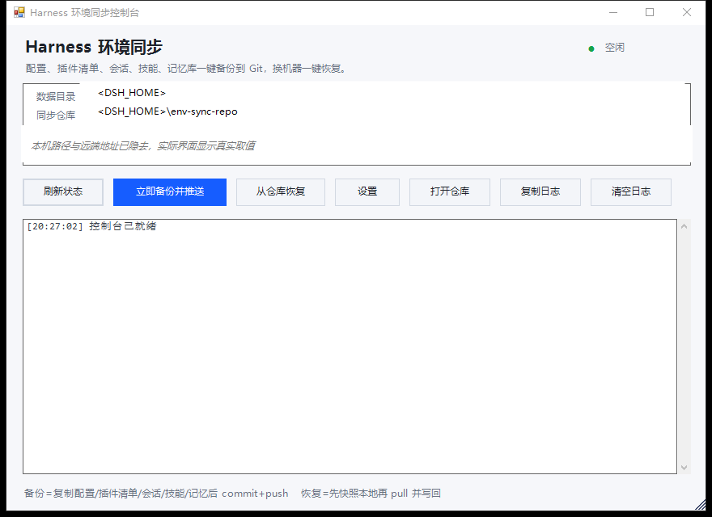

# Harness Env Sync

> A new machine, and Harness is still the one you left yesterday. Config, plugins, sessions, skills and memory stores move as one bundle — and come back with one command.

[](#)
[](#)
[](LICENSE)
[](CHANGELOG.md)

[简体中文](README.md) | **English**



---

## 1. The problem

After a while, everything valuable in DeepSeek Harness lives outside the install directory:

- `.credentials.yaml` — your sign-in state;
- dozens of plugins, each with its own config and state;
- hundreds of session records;
- the skills you have collected;
- the `mnemon` memory stores and attachments.

On a new machine, copying all of that by hand practically means starting over. This tool packs the above into **one Git repository**:

- run `backup` and you get a snapshot you can always roll back to;
- run `restore` on the new machine and you are back to yesterday's state.

No server, no intermediary account — one Git repo, two actions.

## 2. Three forms, one engine

| Form | Best for | How to start |
| --- | --- | --- |
| Desktop console | People who prefer not to touch a terminal | Double-click `HarnessEnvSync.exe`, then click "Back up and push now" |
| Harness plugin | Driving it from inside a conversation | Install it into Harness, then say "back up my environment" or "restore my environment" |
| Command-line engine | Scheduled tasks, scripts, CI | `engine\env-sync.ps1 -Mode backup` |

All three read and write the **same** `env-sync.json`: change a setting in the console and the plugin tool picks it up immediately, and vice versa. There is never a second copy of the config to keep in sync.

## 3. Quick start

```text
1) Create a PRIVATE Git repository (Gitee or GitHub), and copy its tokenized remote URL
2) Unzip HarnessEnvSync-0.3.0.zip anywhere, then double-click HarnessEnvSync.exe
3) Settings → paste the remote URL → Save → Back up and push now
4) On the new machine: install Harness → unzip the same package → paste the same URL
   → restore from the repository → restart Harness
```

Step-by-step installation notes are in [`发布说明.md`](发布说明.md) (Chinese).

## 4. Automatic path detection

| Item | Default behaviour |
| --- | --- |
| Data directory | The `DSH_HOME` environment variable, otherwise `data` next to the program |
| Sync repository | `<data directory>\env-sync-repo` |
| git | Harness' bundled `tools\MinGit\cmd\git.exe` when present, otherwise `git` from PATH |

If the detected values are wrong, set them manually in Settings; **leaving a field empty always means auto**.

## 5. What gets synced

| Included | Contents |
| --- | --- |
| `.credentials.yaml`, `.anonymous-user-id` | Sign-in state and identity |
| `profiles\desktop\*` | Active plugin manifest and workspace config |
| `storages`, `.meow-smooth`, `dsh-market`, `dsh-windows-mcp.*` | Each plugin's own config and state |
| `sessions` | Session history |
| `skills` | Skills |
| `mnemon` | Memory stores |
| `attachments` | Attachments |

Excluded: `node_modules`, `speech-to-text`, caches and `logs`. They can be reinstalled on the target machine; keeping them out stops the repository from being bloated by binary dependencies.

## 6. Security boundaries

- **Keep the backup repository private**: `.credentials.yaml` travels with it.
- A tokenized remote URL stays **on the local machine only** (`env-sync.json` and the local git config); it is never written into repository content, and both the UI and tool results always show it as `https://***@host/...`.
- Before a restore, everything about to be overwritten is snapshotted to `<parent of data directory>\env-restore-backup-<timestamp>`; if anything goes wrong, copy it straight back.
- Release packaging is done by `Build-Release.ps1`: before building it scans for tokens, private repository URLs and absolute local paths, and refuses to produce a package if any are found.

## 7. FAQ

**Where does git come from?**
Harness' bundled `tools\MinGit\cmd\git.exe` is preferred; otherwise `git` from PATH. You never need to hard-code an absolute path in Settings.

**Plugins do not work after a restore.**
A restore moves files only; `node_modules` is not synced. Reinstall dependencies in `profiles\desktop`, then restart Harness.

**I just want to see the status, without touching data.**
Run `engine\env-sync.ps1 -Mode status`, or call `env_sync_status` in a conversation.

**Will the repository keep growing?**
Sessions are committed incrementally, and `node_modules` and caches are excluded; growth tracks session volume, and `git gc` reclaims space.

## 8. Layout

```text
EnvSyncConsole.ps1            Desktop console (WinForms, PowerShell 5.1 compatible)
HarnessEnvSync.exe            Windowless launcher (compiled from launcher.cs)
启动环境同步控制台.vbs         Alternative entry point without a console window
engine\env-sync.ps1           Engine: status / backup / restore, runnable standalone
plugin\dsh-env-sync\          Harness plugin (status, backup, restore, open console)
Build-Release.ps1             Produces the clean release package
发布说明.md                    Step-by-step install notes (Chinese)
docs\images\                  Screenshots
```

## 9. Version

See [CHANGELOG.md](CHANGELOG.md).

## License

MIT — see [LICENSE](LICENSE). Author: D2W.
