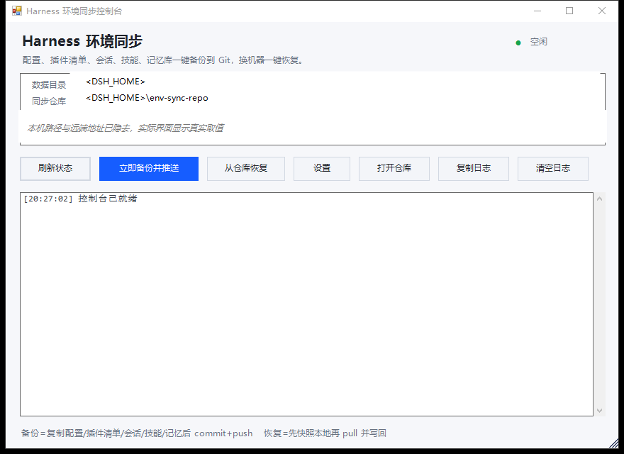

# Harness Env Sync · 环境同步

> 换台电脑，Harness 还是昨天那个 Harness。配置、插件、会话、技能、记忆库整包搬走，一条命令搬回来。

[](#)
[](#)
[](LICENSE)
[](CHANGELOG.md)

**简体中文** | [English](README.en.md)



---

## 一、它解决什么问题

DeepSeek Harness 用久了，真正值钱的东西都不在安装目录里：

- `.credentials.yaml` 里的登录凭证；
- 几十个插件，以及每个插件各自的配置与状态；
- 上百个会话记录；
- 自己攒下来的 skills；
- `mnemon` 记忆库与附件。

换一台机器，靠手抄基本等于重来。这个工具把上述内容**打包进一个 Git 仓库**：

- 平时 `backup` 一次，就是一份可回溯的快照；
- 换机器 `restore` 一次，就回到昨天的状态。

不需要服务端、不需要注册中间账号——一个 Git 仓库，两个动作。

## 二、三种形态，共用一个引擎

| 形态 | 适合谁 | 怎么开始 |
| --- | --- | --- |
| 图形控制台 | 不想碰命令行 | 双击 `HarnessEnvSync.exe`，点「立即备份并推送」 |
| Harness 插件 | 想在对话里直接指挥 | 装进 Harness，说「备份一下环境」或「把环境恢复过来」 |
| 命令行引擎 | 计划任务、脚本、CI | `engine\env-sync.ps1 -Mode backup` |

三者读写**同一份** `env-sync.json`：控制台里改的设置，插件工具立刻生效，反之亦然。没有第二份配置需要同步。

## 三、快速开始

```text
1) 建一个【私有】Git 仓库（Gitee / GitHub 均可），拿到含令牌的仓库地址
2) 解压 Release 里的 HarnessEnvSync-0.3.0.zip 到任意目录，双击 HarnessEnvSync.exe
3) 设置 → 填远端地址 → 保存 → 立即备份并推送
4) 换机器：装好 Harness → 解压同一个包 → 填同一个地址 → 从仓库恢复 → 重启 Harness
```

安装细节见 [`发布说明.md`](发布说明.md)。

## 四、路径自动探测，无需改脚本

| 项目 | 默认行为 |
| --- | --- |
| 数据目录 | 取环境变量 `DSH_HOME`，否则取程序同级的 `data` |
| 同步仓库 | `<数据目录>\env-sync-repo` |
| git | 优先用 Harness 自带的 `tools\MinGit\cmd\git.exe`，否则用 PATH 中的 `git` |

探测结果不对时，在「设置」里手动指定即可；**留空永远等于自动**。

## 五、同步范围

| 纳入同步 | 内容 |
| --- | --- |
| `.credentials.yaml`、`.anonymous-user-id` | 登录凭证与身份 |
| `profiles\desktop\*` | 当前在用插件清单与工作区配置 |
| `storages`、`.meow-smooth`、`dsh-market`、`dsh-windows-mcp.*` | 各插件自己的配置与状态 |
| `sessions` | 会话记录 |
| `skills` | 技能 |
| `mnemon` | 记忆库 |
| `attachments` | 附件 |

不纳入同步：`node_modules`、`speech-to-text`、缓存、`logs`。这些在目标机器重装即可，避免仓库被二进制依赖撑大。

## 六、安全边界

- **备份仓库请设为私有**：`.credentials.yaml` 会随仓库走。
- 带令牌的远端地址只落在**本机**（`env-sync.json` 与本地 git 配置），不进仓库内容；界面与工具返回值里一律显示为 `https://***@host/...`。
- 恢复前，会把即将被覆盖的本地内容快照到 `<数据目录上一级>\env-restore-backup-<时间戳>`；出问题直接拷回。
- 发布打包由 `Build-Release.ps1` 完成：打包前扫描令牌、私有仓库地址与本机绝对路径，命中即拒绝出包。

## 七、常见问题

**git 从哪来？**
优先 Harness 自带的 `tools\MinGit\cmd\git.exe`；没有则用 PATH 中的 `git`。都不必在设置里写死绝对路径。

**恢复后插件没生效？**
恢复只搬文件，`node_modules` 不同步。到 `profiles\desktop` 重装一次依赖，再重启 Harness。

**只想看状态、不动数据？**
命令行 `engine\env-sync.ps1 -Mode status`，或对话里调用 `env_sync_status`。

**仓库会不会越来越臃肿？**
会话按增量提交，`node_modules` 与缓存被排除；仓库体积主要随会话增长，可用 `git gc` 回收。

## 八、目录结构

```text
EnvSyncConsole.ps1            图形控制台（WinForms，PowerShell 5.1 兼容）
HarnessEnvSync.exe            无控制台启动器（launcher.cs 编译）
启动环境同步控制台.vbs        免黑窗的另一条启动入口
engine\env-sync.ps1           引擎：status / backup / restore，可独立运行
plugin\dsh-env-sync\          Harness 插件（状态查询、备份、恢复、打开控制台）
Build-Release.ps1             生成干净发布包
发布说明.md                    逐步安装说明
docs\images\                  界面截图
```

## 九、版本

见 [CHANGELOG.md](CHANGELOG.md)。

## 许可证

MIT，见 [LICENSE](LICENSE)。作者：atianxu。
